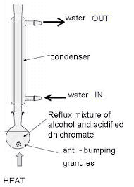
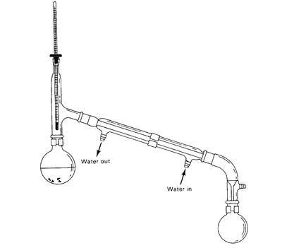

# Oxidation of Propan-1-ol to Produce Propanal and Propanoic Acid

**Method**:

* Measure 20 $cm^3$ of acidified potassium dichromate solution into a pear-shaped flask. Cool down the flask using an ice bath.
* Add anti-bumping granules to the flask as they promote even boiling by providing a surface for (small) bubbles to form.
* Add 1 $cm^3$ of ethanol dropwise to the pear-shaped flask using a pipette. Stir to ensure complete mixing.
* Place the flask in a water bath and set up a **reflux apparatus**.
  * Heating under reflux prevents the loss of any volatile substances,
  * To **completely** oxidise a primary alcohol, forming carboxylic acid.

* Heat it using a Bunsen burner for 10 minutes, not allowing any vapour to escape.
* To prepare an aldehyde instead, a distillation apparatus should be used.
  * Distillation apparatus facilitates incomplete oxidation of primary alcohols, forming aldehydes.
  * This distillation apparatus prevents further oxidation of the primary alcohol into carboxylic acid (Remember: Primary alcohols are first oxidised into aldehydes before carboxylic acids).
  * This apparatus has no condenser, so the products are not sent back to react further, unlike the heat under reflux apparatus.
  * As a result, the aldehyde is **distilled off.**

