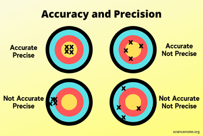

# Accuracy and Precision

* Accuracy is how close the calculated value is to the true value.
* Precision is how close the calculated values are to each other.

## Error

* The difference between the measured and true value.
* Mistakes and errors are not the same.
* Errors can be random or systematic.
  * Random errors are caused by unpredictable variations in conditions.
  * Systematic errors constant or predictable, often because of the apparatus used.