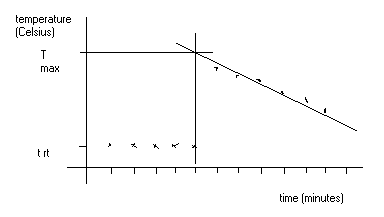

# Energetics

## Enthalpy Change

$Q = mc\Delta T$

* Q represents the heat energy (J)
* m is the mass of water (g)
* c is the specific heat capacity of water (4.18 $J{g}^{-1}K^{-1}$)
* $\Delta T$ is the change in temperature (°K)
* The temperature change from a graph is found by extrapolation of the line of best fit, and the point of intersection is taken to be the maximum temperature reached. This temperature is separated from the initial temperature.

$\Delta H=\frac{-Q}{\text{Moles}}$

* Where ΔH is the enthalpy change
* Where Q is in kJ
* $\Delta H$ is given by kJ$^{-mol}$