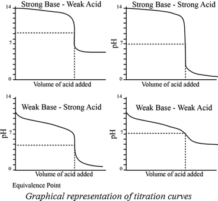

## pH curves

* pH curves show how the pH of a buffer solution changes, and these curves can have different equivalence points depending on the reaction:
* Strong Acid + strong base $\rightarrow$ pH 7
* Weak acid + weak base $\rightarrow$ equivalence point cannot be determined
* Strong acid + weak base $\rightarrow$ pH < 7 (more acidity)
* Strong base + weak acid $\rightarrow$ pH > 7 (more basicity)

* For diprotic and triprotic acids (acids with two or three protons to donate, e.g. $H_{2}SO_{4}$, $H_{3}PO_{4}$), there are multiple equivalence points on the curve
* $pK_{a}$ can be found by using a pH curve as it is equal to the pH at the half equivalence point
* Indicators have different ranges, so they are used for various chemical reactions as they change colour at different pHs. So, selecting an indicator with the same range as the equivalence point is important, which can be found in the data booklet.