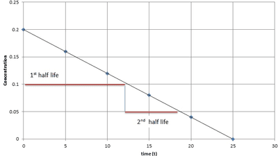

## Orders of Reaction

* Zero Order: the reactant has no impact on the overall rate, i.e., the rate does not change when the concentration of the reaction changes. Rate = k
* First Order: the change of reactant is directionally proportional to the change in the rate of reaction. Rate = k[A]
* Second order: The rate of reaction is proportional to the concentration squared. Rate = $k[A]^2$
* The order can be worked out from concentration-time graphs:
* If the graph is linear, the order is 0 as the rate is the gradient, and the gradient does not change.
* Second-order reaction curves for concentration-time graphs will have a larger ‘kink’ or ‘curve’ in the graph than first order
* You can work out the rate equation using an initial rates table
* Half-life: the time it takes for the concentration of reactants to halve
* In first-order reactions, the half-life is constant throughout the reaction, and you can work it out using a graph:

* The order of a reaction can be determined experimentally by measuring the rate of the product or reactant over time and then drawing a concentration-time/mass-time/volume-time graph