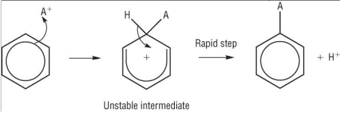
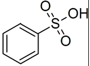
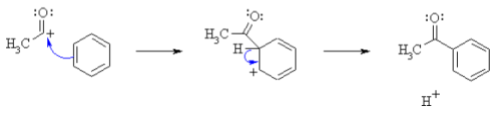

## Reactions of Benzene

* Benzene undergoes electrophilic substitution reactions as it has a high region of electron density, so electrophiles can easily attack it. The electrophile temporarily breaks the ring of delocalized electrons before it is restored to form the product. The electrophile replaces a hydrogen atom on the benzene: \n  
* $FeBr_{3}$ or $AlBr_{3}$ is a catalyst that can be used in halogenation as it creates $Br^{+}$ as an electrophile from bromine. $FeCl_{3}$ and $AlCl_{3}$ can be used for chlorine.
* In nitration, $NO_{2}^{+}$ is generated using HNO3 and a concentrated sulfuric acid catalyst. ($HSO_{4}$ - is made) This temperature is 55 degrees Celsius to avoid further substitution reactions. To make aromatic amines, only one substitution is required.
* To convert the nitrobenzene into phenylamine, heat it with tin and concentrated HCl
* When sulfur trioxide and fuming sulphuric acid are added to benzene, benzenesulfonic acid is formed. \n  
* Benzene can also act as a nucleophile and attack acyl chlorides. Acyl Chlorides react with $AlCl_{3}$ or $FeCl_{3}$ catalyst to form an intermediate compound. This is called Frediels-Craft Acylation. \n  
* Sometimes, benzene rings can be called phenyls depending on the priority of the functional group.
* The $H^{+}$ atom that got replaced reacts with the intermediate $AlCl^{4-}$, $AlBr^{4-}$, $FeBr^{4-}$, etc to regenerate the catalyst.

