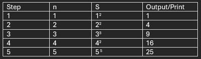

# **Algorithms**

## Introduction to Algorithms

### **Sequence of Instructions**

Algorithms consist of a number of instructions that are carried out to solve a problem. An algorithm is satisfied once all instructions produce expected outcomes.

Example 1:

A integer is considered “valid” by following the algorithm:

1. Write down integer

2. Square each digit and add them

3. If outcome equals 1 integer is valid

4. Lets take integer as 100

5. Squaring each digit we get : $1^2+0^2+0^2=1$

6. Since total sum = 1, integer is “Valid”

7. Repeat until expected outcome is reached (trapped in a cycle)

### **Using trace tables for algorithms**

Trace tables are tables consisting of columns and rows each representing a certain instruction, trace tables are used to understand how algorithms process data.

Example algorithm using trace tables:

1. Let n = 1, S = 1

2. Print S

3. Let n = n + 1

4. Let S = $n^2$

5. If n<5, go to step 2

6. If n=5, stop

