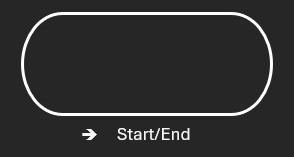
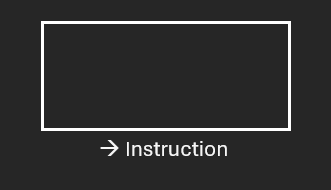
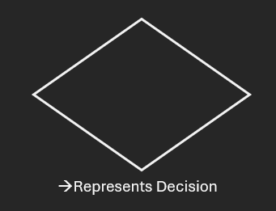

## **Flow Charts**

### Flow charts are visual representations of step by step instructions, flow charts use certain shapes to represent a function

The start/end boxes help in determining where an algorithm begins and where it

ends, ensuring clarity

The instruction boxes display all tasks that need to be carried out, such as setting

constants, calculations or change in variable, an example of a instruction box

would be,

*let n = 0*

 The decision box represents a choice or a decision to be carried out, it decides

which part of the algorithm will continue given certain conditions. For eg: *Is n>20*

would be placed in the decision box, if n is greater than 20 algorithm will continue else it will stop