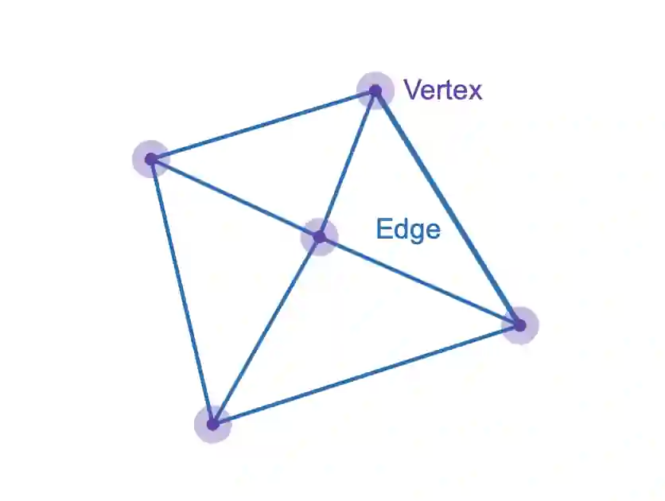
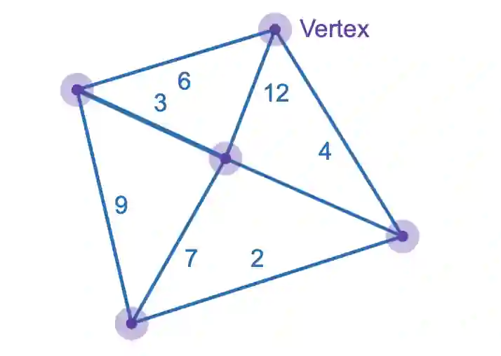
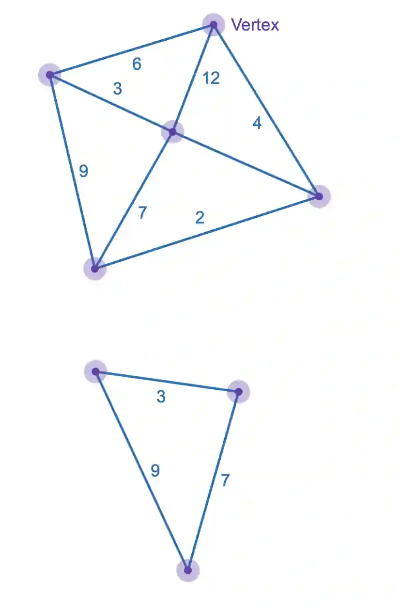

# Introduction to graphs terminology

## Definitions :

1. Graphs- Vertices/Nodes connected by edges

   

2. Weighted graph- Graph with a value associated with each edge

   

3. Subgraph- A version of a graph that originates from the main graph

