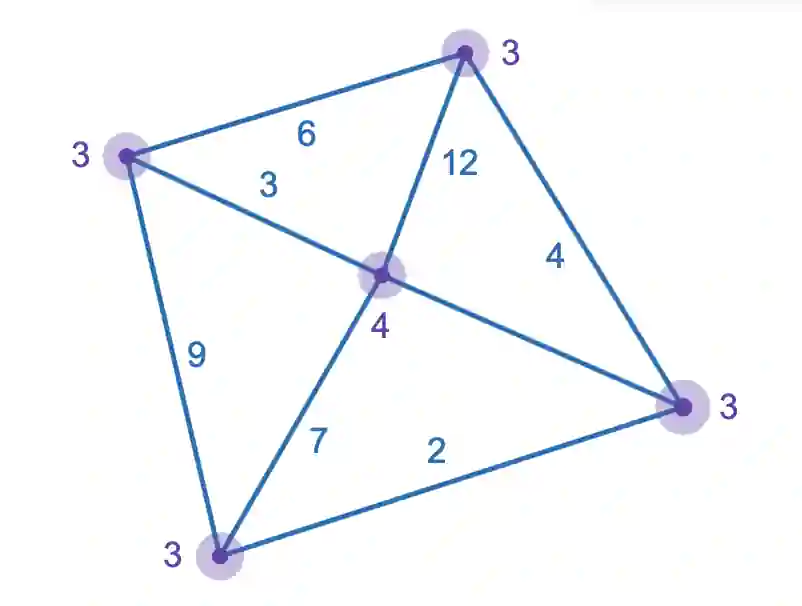
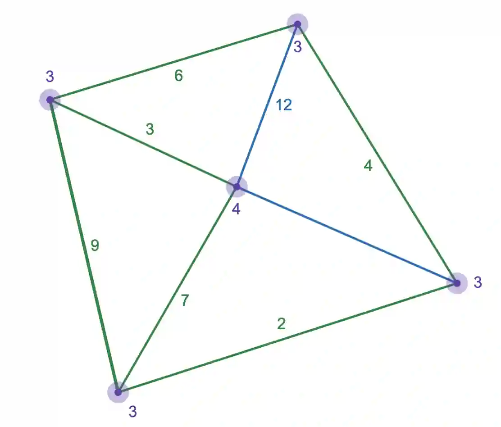
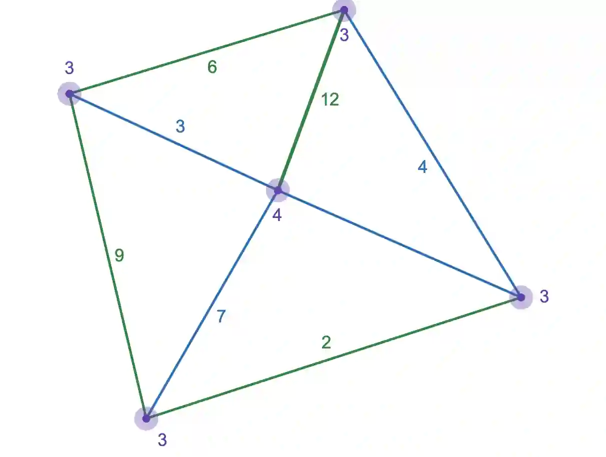

1. Degree- Number of edges (lines) connected to a vertex, the number at every vertex (in purple), represents the degree

2. Walk- A route along a graph, allowing to cover each vertex and edge multiple times.

   

3. Path- Similar to a walk, except vertices cannot be repeated more than once

