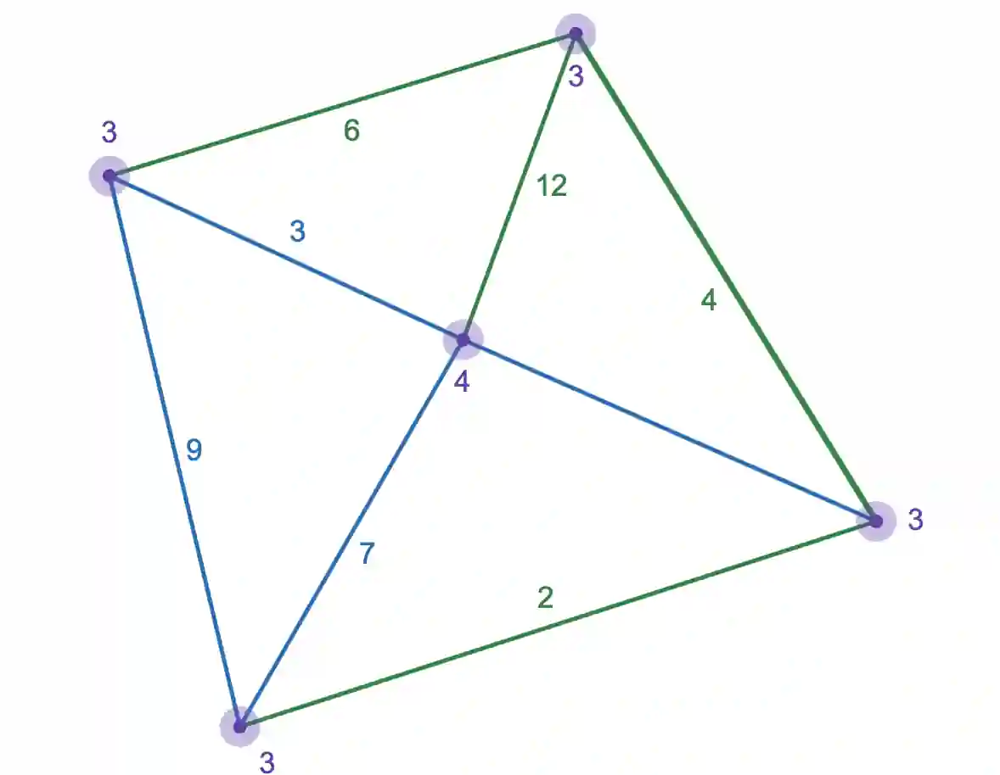
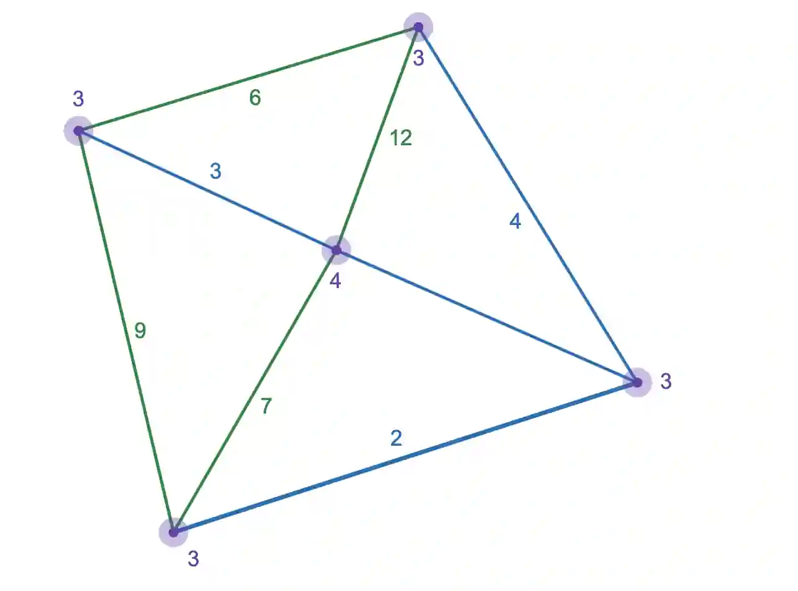
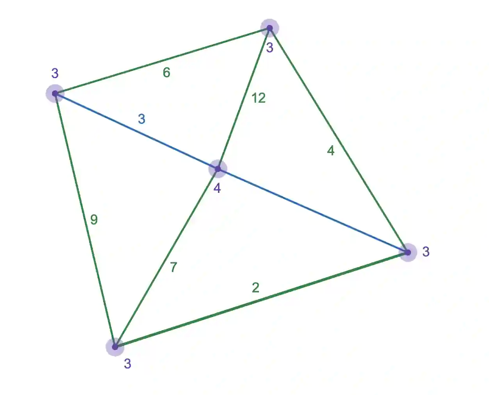

1. Trail- Similar to a walk, except edges cannot be repeated more than once

2. Cycle- A walk where route’s end vertex is the same as the start, but all other vertices are only visited once.

3. Hamiltonian Cycle- A cycle that that visits each vertex only once, forming a closed loop

