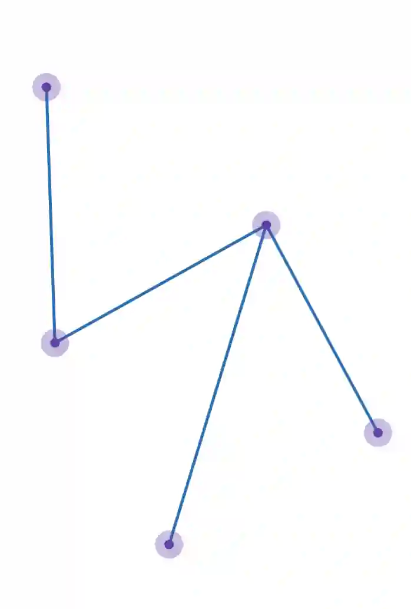
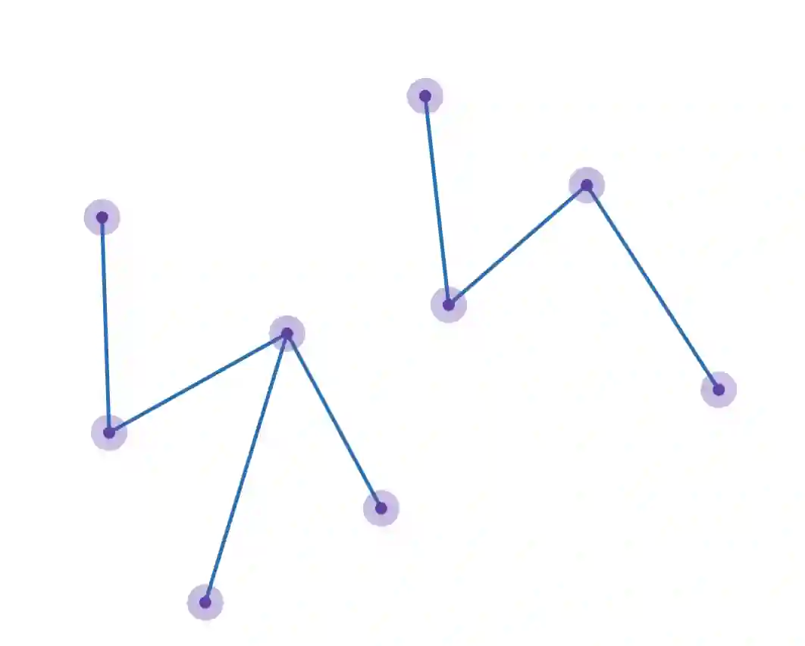
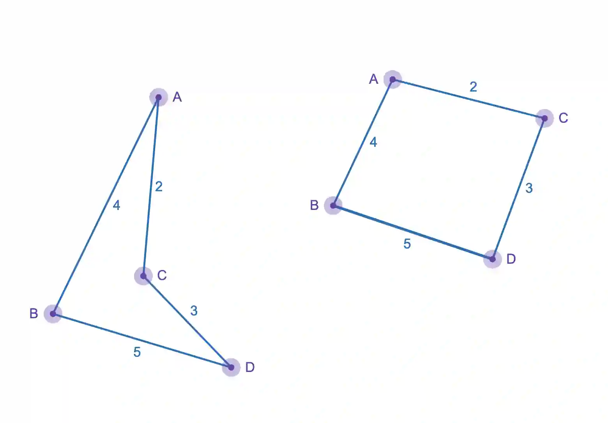

1. Tree- A graph thats connected by each vertex, but forms no cycle

2. Spanning tree - A subgraph of a tree, that includes all vertices of the original graph and must be a tree

3. Isomorphic graphs - Graphs that are drawn differently but represent the same information

