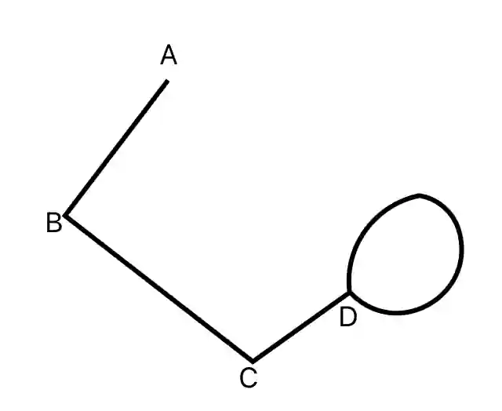
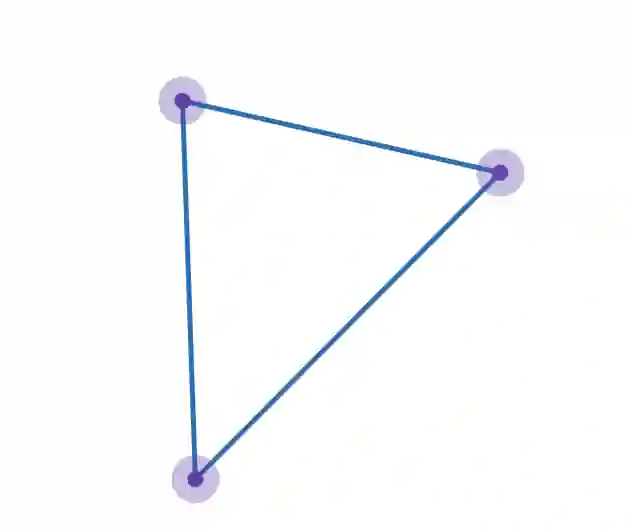
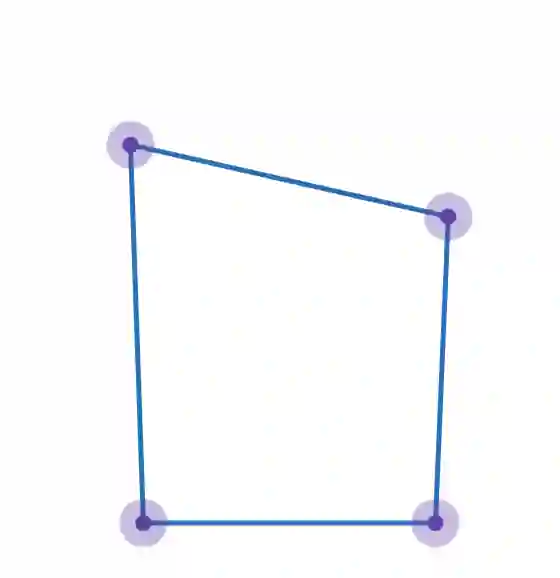

Loop: A type of edge that connects a vertex back to itself, forming a curved pathway.

2. Complete graph- An undirected graph in which where every pair of vertices is connected by a separate edge. Every distinct pair of vertices is connected to every other vertex.

3. Simple graph- A basic graph with no loops and no multiple edges across a single pair of vertices

   