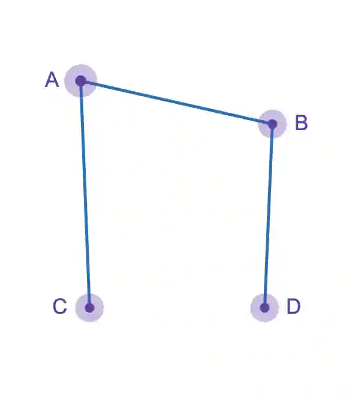

## Handshaking Lemma

A concept that states the sum of degrees of all points in any undirected graph is equal to twice the number of edges, since each edge connects 2 vertices, this concept works on all finite graphs.

Step 1 : Find sum of degree

Vertex A : 2

Vertex B : 2

Vertex C : 1

Vertex D : 1

Total sum of degrees: 6

Number of edges : 3

Therefore lemma holds, since sum of degrees of all points is twice the number of edges.