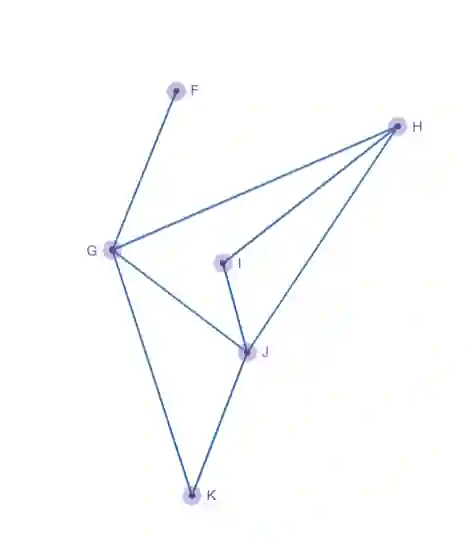
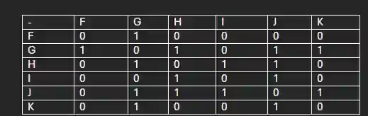

## Representing graphs using matrices

An adjacency matrix is used to represent a graph or network, provides information on how many edges are connected to a vertex directly.

Below is an example of an adjacency matrix of the given graph:

