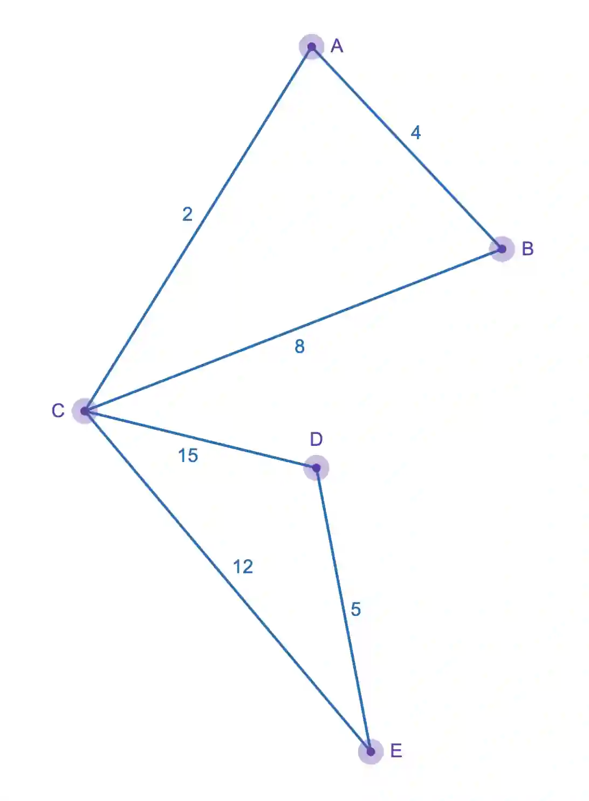

**Distance matrix**

A distance matrix is way to inform us about the actual distance between the matrices, unlike the adjacency matrix that tells us whether the nodes are directly connected or not. Distance matrix can only apply if the graph is weighted ( graph where vertices have a value associated ).

#|
||

-

|

A

|

B

|

C

|

D

|

E

||
||

A

|

0

|

4

|

2

|

17

|

14

||
||

B

|

4

|

0

|

8

|

21

|

18

||
||

C

|

2

|

8

|

0

|

15

|

12

||
||

D

|

17

|

21

|

15

|

0

|

5

||
||

E

|

14

|

14

|

12

|

5

|

0

||
|#

