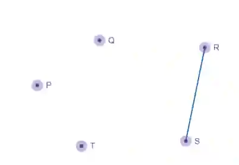
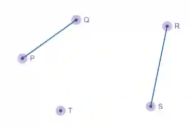
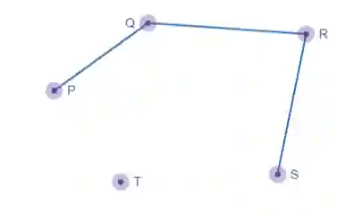
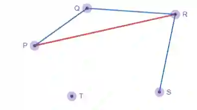
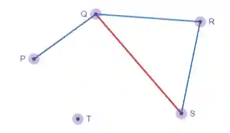
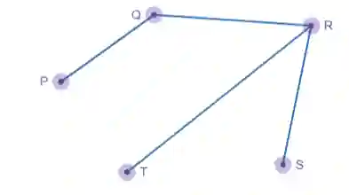
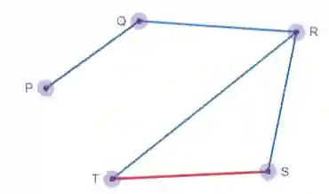
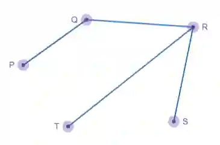

# Kruskal’s Algorithm

Kruskal’s algorithm is used to find the spanning tree, it can be used to find the most efficient route to connect the nodes while keeping total distance, cost and time as low as possible.

## Steps for the using Kruskal’s Algorithm:

1. Sort all arcs in ascending order of weight

2. Select arc of least weight to start the graph

3. Consider next arc : If the following arc is forming a cycle- it must be rejected  ( Remember that Tree is a graph that doesn’t have cycles !!). If the next arc doesn’t form a tree add the arc to the graph

4. Repeat steps until vertices are connected and a minimum spanning tree is formed.

## An example question of using Kruskal’s algorithm :

Question: Construct a spanning tree using Kruskal’s algorithm with the following vertices and weights.
Given vertices and weights: P,Q,R,S,T

P-Q : 3

P-R: 5

Q-R: 4

Q-S: 6

R-S: 2

R-T: 7

S-T: 8

Step 1: Listing all arcs in ascending order

1. R-S

2. P-Q

3. Q-R

4. P-R

5. Q-S

6. R-T

7. S-T

Step 2: Drawing first arc

Second arc

Third arc

Arc P-R will be rejected as it creates a cycle between PQR

Similarly, Arc Q-S will also be rejected as it creates a cycle

Next Arc R-T will not be rejected since it creates no cycle

Arc S-T will also be rejected

Following the steps our final spanning tree using Kruskal’s method we get :

