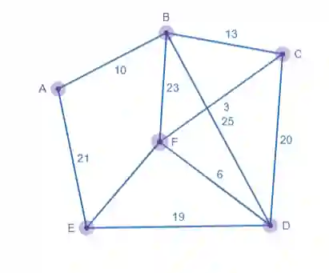
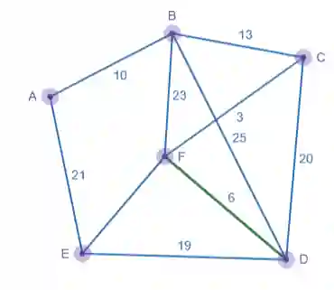
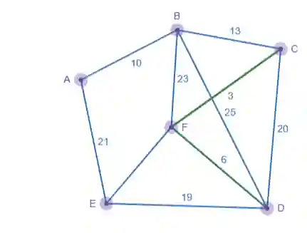
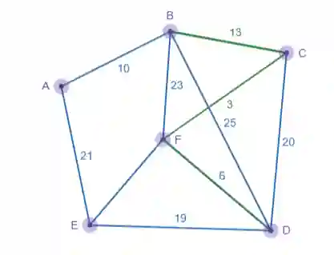
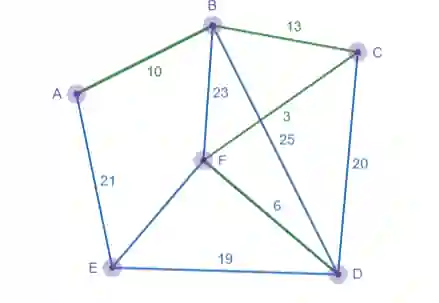
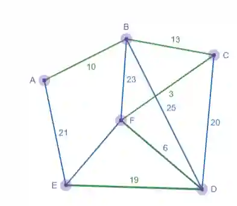
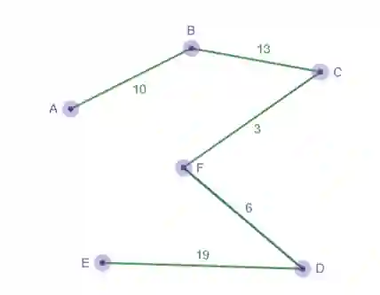

# Prim’s Algorithm

Prim’s algorithm is another method to find a minimum spanning tree, it starts with a single vertex and repeatedly adds edges already in the MST to a vertex.

Steps for using Prim’s algorithm:

1. Start by choosing any vertex from the diagram

2. Choose the arc of least weight that joins the chosen vertex, if there are multiple arc of the same weight you can choose any one

3. Follow the vertex of the chosen arc and repeat step 2 until a tree is formed

4. List the arc in the correct order

Example of using Prim’s algorithm

Select a starting vertex, we’ll start with D

Choose the least weight of arc connecting to D, in this case it’s F-D

Following the same order, next least arc is F-C

Next least arc added is B-C

Next arc added is B-A

Next arc is D-E, it will not be A-E, since D-E (19) is of lesser weight than 21 any other arc such as 23,25,20 would create a cycle.

Final spanning tree.