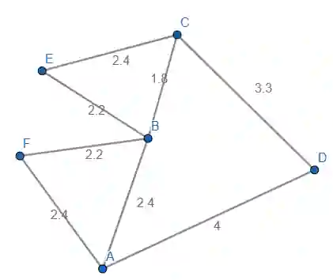
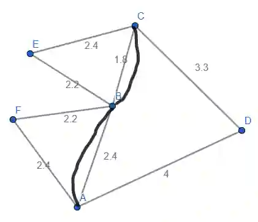

# Route inspection Algorithm

Route inspection algorithm can be used to find the shortest route, to cover all edges at least once and return to its starting point. Route inspection algorithm is used to find the minimum distance to make the route as efficient as possible it uses the concept of Eulerian graphs.

If the graphs is Eulerian, this problem can be solved easily since no vertices will have to be repeated twice and the shortest route is simply adding the weight of all routes.

Steps to solve this problem if graph is Semi-Eulerian:

The above graph is Semi-Eulerian, nodes A and  C are odd vertices since they have 3 vertices connecting to them

This way we have 2 odd vertices making the graph Semi-Eulerian

If we transverse twice around the edges making A and C even, the graph become Eulerian

Transversing twice around vertices A and C, make the odd vertices even, making the graph Eulerian.