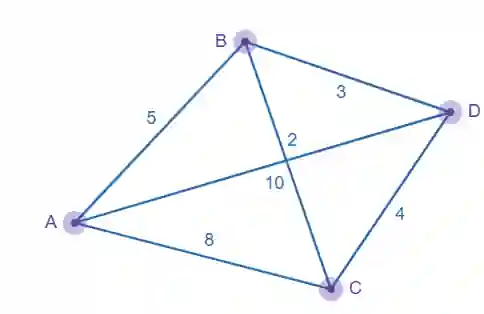
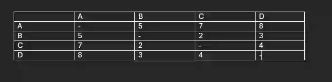

# Table of least distances

To create a table of least distance you create a distance matrix, except instead of adding the direct weight between 2 vertices you calculate the smallest possible weight.

Example :

The above image shows the table of least distances for the graph, notice that even though A-D had a direct connection of weight 10, reaching D through B is of weight 8 which is lesser than 10

Even for A-C, reaching C through B gave a value of 7 being lesser than 8.