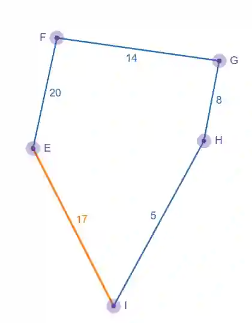

# Using M-S-T to find an upper bound

A minimum spanning tree can be used to find the upper bound, to use M-S-T, we can double each arc this helps in visiting each vertex and returning to starting vertex. The initial upper bound can be found by finding weight of MST and doubling the value.

To find a minimum spanning tree we can make use either Kruscal’s or Prim’s algorithm, if we’re given a distance matrix we can only use Prim’s algorithm.

Example:

Find the initial upper bound given that the minimum spanning tree weighs 79.

Initial upper bound = 79 x 2= 158

## Improving an initial upper bound

Optimal solution are the closest when the upper bound found is the smallest value possible and lower bound found is the largest value possible.

To improve an upper bound we can find shortcuts in the minimum spanning tree.

Example :

Arc E-I was cut off since due to Minimum spanning tree, however adding this shortcut makes the upper bound much lower

Initial upper bound = 2 x (20+14+8+5)= 96

Improved upper bound = 17+20+14+8+5= 64

Adding this shortcut prevents from doubling each arc, since there is no reason to repeated EF,FG,GH and HI, adding EI starts and ends at the same vertex