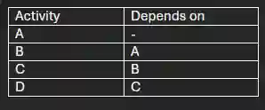

# Using a Precedence table

A precedence/dependence table represents the order of events that will occur in a project. This table represents activities that must be done before an event can be carried out

Example :  Project= Constructing a window

1. A-Setup costs and type

2. B-Build Frame

3. C-Paint frame

4. D-Fitting in glass

Activities above such as Building frame can only be done once costs and type of frame is selected, this can be represented on a precedence table

