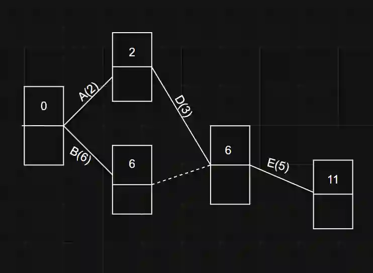
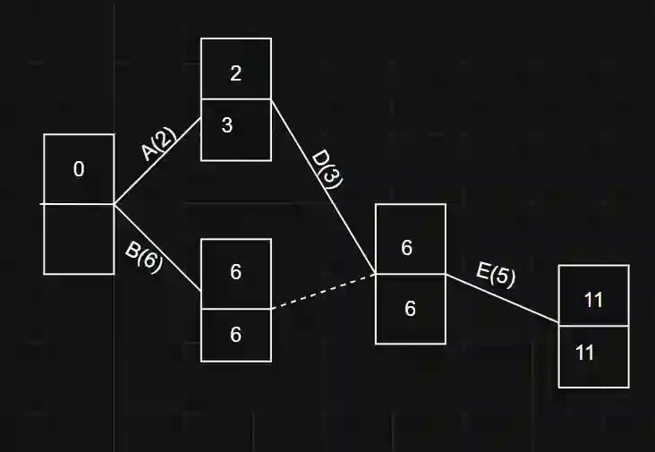

# Calculating early event times

Above diagram represents a activity diagram, the dotted line represents a dummy activity, which is why no duration of time is present.

The top box represents the early event time and bottom box represents late even times.

To calculate early event time you start from the source node the represents (0) and you add the duration node by node.

Notice that there are 2 paths leading to E, event D and the dummy activity, however we calculate the highest possible value for early event times, this is because if one predecessor activity finishes later than the other, the event cannot take place.

# Calculating Late event times

Calculating late event times are done by a backward pass, you start from the last node (make sure that the last node must have the same early and late event time) and move your way backwards.

Float-

Notice that on node A, the early and late event time do not have the same value, this is because the late event node has a float of 1hr, this value represents how much the activity can be delayed by.

Critical Activities-

Activities with zero float are known as critical activities and cannot be delayed as this will cause in a disruption of the events