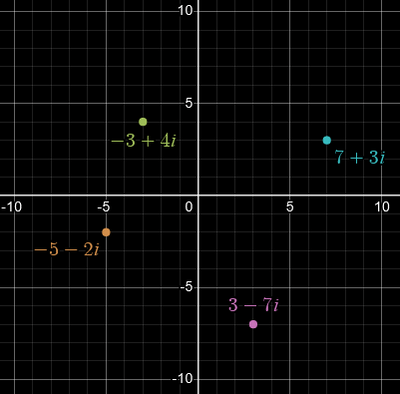

## Argand diagrams

- Argand diagrams are used to represent complex numbers
  - x axis represent the real component...
  - ...while y axis represent the imaginary component

- when the complex number $a + bi$ is plotted onto the argand diagram, their coordinates are $P(a,b)$ (they can also be represented as vectors in the form $\vec{xy}$)

## Modulus and Argument

- The modulus (absolute value) is the magnitude of a complex number, it is the distance between the complex number and the origin in the argand diagram
  - $|z| = \sqrt{a^2 + b^2}$, this is because the modulas of a complex number is the hypotenuse between the real and imaginary part

- The argument (arg z) is the angle between the line of a complex number and the REAL positive axis, measured in a anticlockwise direction
  - $tan\theta = \dfrac{b}{a}$ 

