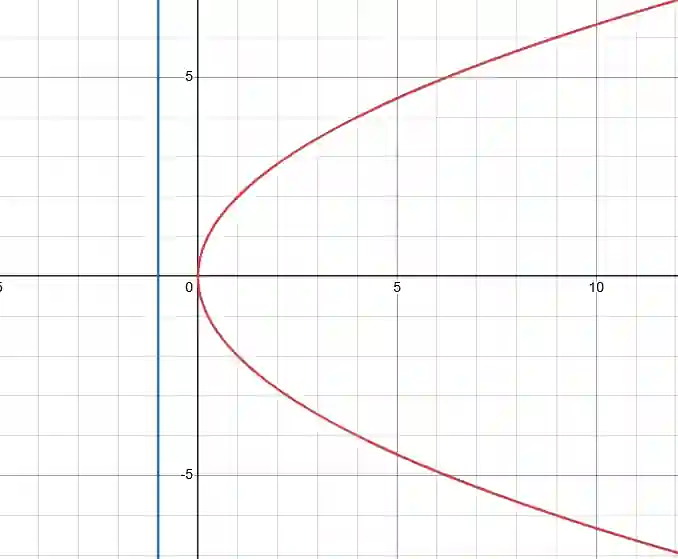

## The general equation of a parabola and rectangular hyperbola

$$

x = at^2, y =  2at

$$

* Above is the general parametric equations for a parabola, its Cartesian counter part being $y^2 = 4ax$
* The curve is symmetrical about the $x$ axis
* **parabola** - where the distance between a point on the curve and a fixed coordinate $S$ (called the focus) is the same as that same point and a fixed straight line called the directrix
  * The focus of a parabola has the coordinate $(a,0)$

  * the directrix as the equation $x + a = 0$ (followed explicitly in this format)

---

$$

x = ct, y = \frac{c}{t}

$$

* above is the general parametric equations for a rectangular hyperbola, its Cartesian counter part being $xy = c^2$
  * has asymptotes of $x = 0$ and $y = 0$