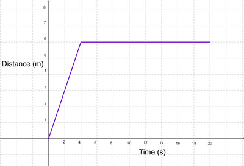
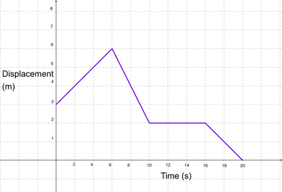

## Motion Graphs I

* Label the required speeds and times clearly (using a scale is not needed).
* You might need to use the $suvat$ formulae to calculate the values used in the graph.

### **Distance-Time Graph**

* Inclined line → Constant velocity
* Horizontal line → At rest (velocity is 0)
* Curved line → Changing velocity (acceleration)

   

### **Displacement-Time Graph**

* Inclined line with positive gradient → Constant velocity in a positive direction
* Inclined line with negative gradient → Constant velocity in negative direction
* Horizontal line → At rest (velocity is 0)
* Curved line → Changing velocity (acceleration)

   

