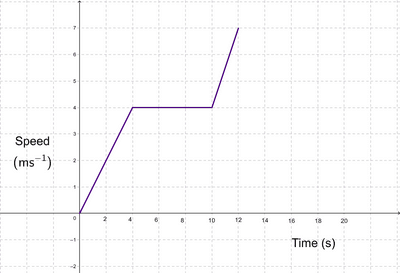
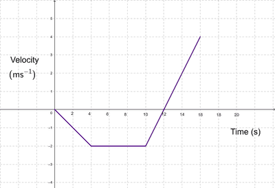

## Motion Graphs II

### **Speed-Time Graph**

* Inclined Straight Line With Positive Gradient → Constant/Uniform Acceleration In Positive Direction
* Inclined Straight Line With Negative Gradient → Constant/Uniform Deceleration
* Horizontal Straight Line → Constant/Uniform Speed
* The total area under the line represents the total distance travelled.
* Gradient represents the acceleration.

   

### **Velocity-Time Graph**

* Inclined Straight Line With Positive Gradient → Constant/Uniform Acceleration In Positive Direction
* Inclined Straight Line With Negative Gradient → Constant/Uniform Acceleration In Negative Direction (or Deceleration)
* Horizontal Straight Line → Constant/Uniform Speed
* Gradient represents the acceleration.
* Area Above x-axis + Area Below x-axis = Total Distance Traveled
* If there is negative velocity then the area above the line and below the x-axis is considered negative displacement.
* Area Above x-axis - Area Below x-axis = Total Displacement

 