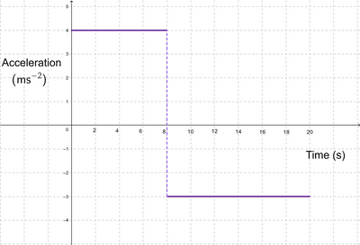

## Motion Graphs III

### **Acceleration-Time Graph**

* Horizontal Straight Line → Constant Acceleration
* The area under the graph represents a change in velocity.
* Use dotted lines to indicate a change in acceleration

   

