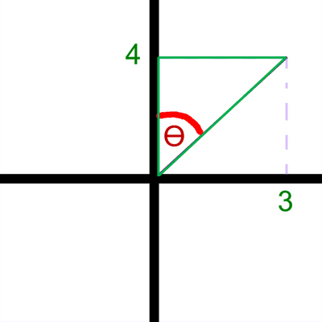

## Solved Example

\[In this question, $i$ and $j$are horizontal unit vectors due east and due north respectively and position vectors are given with respect to a fixed origin.\]

---

A ship $S$ is moving along a straight line with constant velocity. At time $t$ hours the position vector of $S$ is **s** km. When $t = 0$, **s** = 9**i** - 6**j**. When $t$ = 4,

**s** = 21**i** + 10**j**. Find

**a) the speed of $S$,**

**b) the direction in which S is moving, giving your answer as a bearing.**

---

### **a) the speed of $S$**

**1 - Convert the vectors to column vectors:**

* At $t=0$ → s = $\binom{\ 9\ }{\ -6\ }$
* At $t=4$ → S = $\binom{\ 21\ }{\ 10\ }$

**2 - Velocity is required to calculate speed:**

* $r = r_0 + vt$
* The ship moved from position $r_0$ to position $r$ in 4 seconds
* Replace variables by values given

  →$\binom{\ 21\ }{\ 10\ } = \binom{\ 9\ }{\ -6\ } + \binom{\ x\ }{\ y\ }\times{4}$
* Solve → $\binom{\ 21\ }{\ 10\ } = \binom{\ 9\ }{\ -6\ } + \binom{\ 4x\ }{\ 4y\ }$ → $\binom{\ 21\ }{\ 10\ } = \binom{\ 9 + 4x\ }{\ -6 + 4y\ }$
* $9+4x = 21$ & $-6+4y = 10$ → $x = 3$ & $y = 4$
* The velocity is **$\binom{\ 3\ }{\ 4\ }$**

**3 - Find the speed:**

* Use Pythagoras’ theorem to find the magnitude

  of the velocity which is speed
* Speed = $\sqrt{(3)^2 + (4)^2}$ = $5$ $ms^{-1}$

***

### **b) the direction in which $S$ is moving, giving your answer as a bearing.**

**1- Draw the horizontal and vertical axis.**

 

**2- Draw the vector.**

 

**3- Use trigonometry rules to calculate the required angle.**

* Answer is required as a bearing so the angle between the north and the vector is required.

   
* $\tan{\left(\theta\right)}=\frac{3}{4}$ → $\theta=\tan^{-1}{\left(\frac{3}{4}\right)}= 036.9°$

