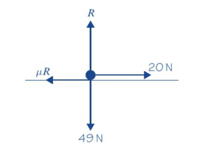

## Horizontal Surfaces

1. Draw a diagram to visualise the problem.
2. Draw the weight and reaction forces.
3. Draw the vertical and horizontal external forces.
4. Draw other forces (forces that are at an angle) and resolve them to their vertical and horizontal components.
5. Draw the friction force (opposite to the direction of motion).
6. Total force upwards = Total Force downwards
7. If the object is stationary, at rest, in limiting equilibrium, not accelerating, or moving with a constant velocity, then the Forces to the right = Forces to the left.

* Example of a diagram:

   

