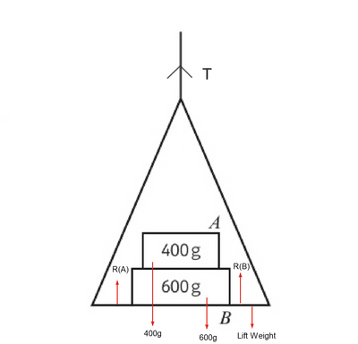

## Lifts

1. Draw a diagram to visualise the problem.
2. Draw the weight and reaction forces.
3. Form an equation for the object.
4. Form an equation for the lift.
5. Form an equation for the system by adding both equations together.

* Diagram Example:

 

