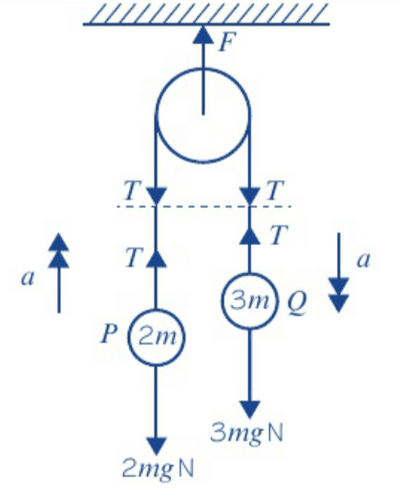
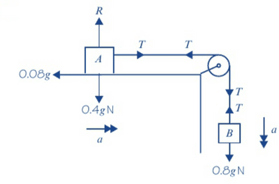

## Connected Particles

### **Car and Caravan**

* Both particles are connected using a rod
* The motor provides a forward driving force
* Tension in the rod pulls the caravan forward and pulls the car backwards

1. Draw a diagram to visualise the problem.
2. Draw the weight and reaction forces.
3. Draw the tension forces in the rod.
4. Form an equation for the car.
5. Form an equation for the caravan.
6. Form an equation for the system by adding both equations together.

### **Pulleys**

* When the string is taut, the acceleration is equal for both connected particles.
* There are two types of pulley scenarios:

  
  1. A pulley with both stings hanging vertically.
  2. A pulley at the end of a horizontal table.
* For the first type:

  
  1. Draw a diagram to visualise the problem.
  2. Draw the weight.
  3. Draw the tension forces in the string.
  4. Form an equation for each object.
  5. Form an equation for the system by adding both equations together.
  6. If an object falls and hits the ground the string becomes slack and the other objects is thrown upwards with acceleration equal to $g$ (-9.81 $ms^{-2}$)
* Example of Diagram:

 

* For the second type:

  
  1. Draw a diagram to visualise the problem.
  2. Draw the weight. (Resolve if the surface is inclined)
  3. Draw the tension forces in the string.
  4. Draw the friction force if the surface is rough (**not** smooth).
  5. Form an equation for each object.
  6. Form an equation for the system by adding both equations together.
  7. If an object falls and hits the ground the string becomes slack and the other objects is moved sidewards with acceleration equal to to $g$ (-9.81 $ms^{-2}$)
* Example of Diagram:

 