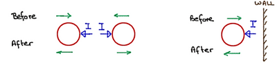

## Colliding Particles

1. Draw a diagram to visualise the problem.

   Example:   
2. Add the masses and velocities to your diagram.
3. Apply the law of conservation of momentum to find the required value.

