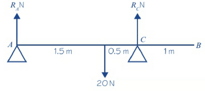

## Moments in Equilibrium

When a rigid body is in equilibrium, the resultant force in any direction is $0N$ and the resultant moment about any point is $0Nm$

1. Draw a diagram to visualise the problem.
2. Add the forces and reaction forces to the diagram

   Example:   
3. Take the moments about the point that makes algebra simple
4. Use the formulas:

   
   1. Total Force Upwards = Total Force Downwards
   2. Total Clockwise Moment = Total Anticlockwise Moment

