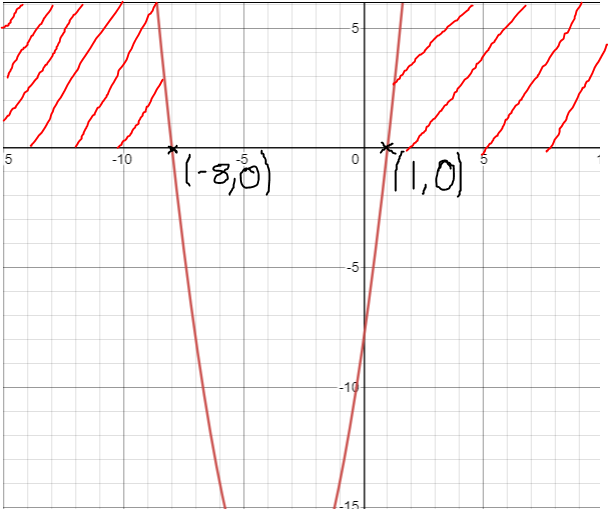

## Inequalities on Graphs

* if $y < f$($x$) or  $y > f$($x$), use a dotted line to represent the line/curve
* if $y \leq f$($x$) or $y \geq f$($x$), use a solid line to represent the line/curve

{Jan 14 - C12}
 
Question 8:
 

Find the range of values of $k$ for which the quadratic equation

$kx^2 + 8x + 2(k+7) = 0$

 

Solution: Since the quadratic equation has no real roots, it can be concluded that $b^2-4ac<0$. Substitute the values to get   $8^2-4(k)(2(k+7))<0$

$64-8k^2-56k<0$
 

$-8k^2+56k-64>0$
 

$k^2+7k-8>0$
 

Find solutions to the equation above
 

(k+8)(k-1) = 0

k+8 = 0 or k-1 = 0

k = -8, 1

 

Sketch a rough graph and shade the requirement to find the range of values for k, which satisfies the inequality.

For $k^2 + 7k - 8 > 0$, to be true
k < - 8 or k > 1