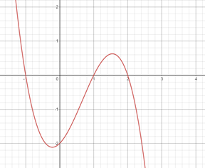

## Cubic Graphs

* Sketching a cubic function:
   * The point(s) where the graph intersects/touches the x-axis can be found by finding the roots of the function
   * A point touches the x-axis when the root of the function is a repeating root
   * A point intersects the x-axis when it is a distinct root
   * The y-intercept of the graph can be found by substituting x=0 into the function.

Cubic Example:
	
$y=(x-2)(1-x)(1+x)$

The roots can be found by substituting y=0 , hence

$(x-2)(1-x)(1+x)=0$

$x=2,1 ,-1$

The y-intercept is found by equation x=0

$y=(-2)(1)(1)$

$y= -2$

The direction of the curve can be interpreted by expanding the brackets to find the coefficient of x^3

In this case the coefficient of $x^3$ is -1, hence as x tends to infinity, y approaches -infinity. And as x tends to -infinity y approaches infinity

Using this information it can be concluded that the points where the graph intersects the coordinate axes are (0,-2), (2,0), (1,0) and (-1,0)

 
