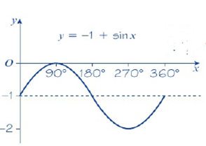

## Example

 A curve with equation $y=f(x)$ passes through the point (3,6) .Sketch the graph of $y = -1 + \sin x$

given a function $f(x) = \sin x$ , the graph $y = -1 + \sin x$ can be treated as a transformation where $y = f(x) - 1$ causing the graph to shift 1 unit down

