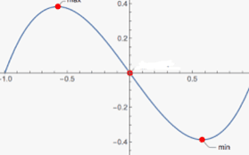

# Differentiation

## Introduction

* The gradient of a point on a curve is the same as the gradient of a tangent to the curve at the given point.
* 1st derivative (used to find the gradient of a curve at a point)
  * y = $x^n$, $\frac{dy}{dx}$ = $nx^{n-1}$
  * $y = f$($x$), when differentiated $\frac{dy}{dx}$ = $f’(x)$
* At stationary points  $\frac{dy}{dx}$ = 0 
* 2nd derivative can be used to find the nature of stationary points:
  * If $\frac{d^2y}{dx^2}$ > 0, stationary point is local minimum
  * If $\frac{d^2y}{dx^2}$ < 0, stationary point is local maximum
  * At stationary points $\frac{d^2y}{dx^2}$ = 0

