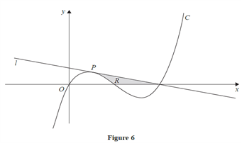

## JUN 16-C12

 

Figure 6 shows a part of the sketch of the curve C with equation:

$y=x(x-1)(x-2)$

The point P lies on C and has the x-coordinate $\frac{1}{2}$
.The line l as shown on figure 6 is the tangent to C at P

a) Find $\frac{dy}{dx}$

______________________________________________________________________________________

Solution:

First expand the bracket and simplify the equation

$y=x(x-1)(x-2)=x^3-3x^2+2x$

Differentiate the simplified equation

$\frac{dy}{dx}=3x^{3-1}-3(2x^{2-1} )+2(x^{1-1})$

$\frac{dy}{dx}=3x^2-6x+2$ 

