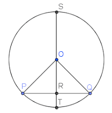

## Key Circle Properties

1. The angle in a semi-circle is always a right angle
2. The discriminant is closely related to the circle when looking at the relationship between lines and circles:

   
   1. A tangent to a circle is where $b^2 - 4ac = 0$
   2. A line separate from a circle is where $b^2 - 4ac < 0$
   3. A chord to a circle is where $b^2 -4ac > 0 $
3. A tangent to a circle is the perpendicular to the radius at the point of intersection
4. The perpendicular bisector of a chord will always pass through the center of a circle
5. In a right-angled triangle inside a circle, the hypotenuse is always the diameter

---

 **The Discriminant of a Circle**

***

 

The perpendicular bisector of a chord always passes through the centre, which is O.