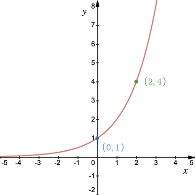

# Exponential and Logarithms

## Exponential Functions

* An exponential function can be written as $y=a^x$

  → Where a is a constant

* Example: $y=2^x$ , $y=(\frac{1}{2})^x$

→ The standard form for an exponential function is $y=a^x$ ; a\>0 and a does not equal 1.

### **Exponential Graph**

→ Key features of exponential graphs:

1. Have an asymptote at y = 0
2. Have a y-intercept at  y = 1