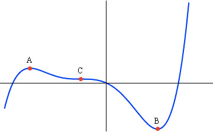

## Stationary Points on a Curve

* A stationary point is any point where the gradient of a curve is equal to 0.

  → The gradient being equal to 0 is represented as $\frac{dy}{dx} = 0$  
* At the maximum point A, $\frac{dy}{dx} = 0$, and $\frac{d^2y}{dx^2} <0$.
* At the minimum point B, $\frac{dy}{dx} = 0$, and $\frac{d^2y}{dx^2} > 0$
* At the point of inflection C, $\frac{dy}{dx} = 0$, as well as $\frac{d^2y}{dx^2} = 0$

