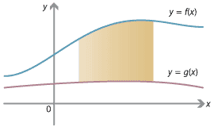

## Area Between 2 Curves

 → For this curve, we can take the right side limit as “b” and the left side limit as “a”.

→To obtain the area between 2 curves, we use $\int_b^a f(x)dx$ - $\int_b^a g(x)dx$

→ Always do the upper curve - the lower curve

---

→ Example: Find the area between the curves of $y=x^2$ and $y=x$

 

---

→ Answer:

1. We first need to find our two limits by equating both the curves together as $x^2$=$x$
2. When solving for x, we get x=0 and x=1 which will be our upper and lower limits respectively.
3. Our final definite integral will be $\int_0^1(x-x^2)dx$ (y=x is the upper line)
4. We get the final answer when evaluating our integral as $\frac{1}{6}$ units.

