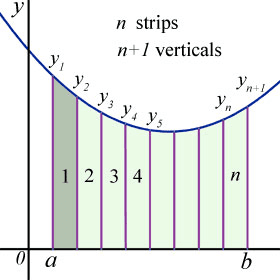

## The Trapezium Rule

* The trapezium rule is another method to find the area under the curve. However, this only gives an approximate value and is not completely accurate.

 

* When trying to find the area of the curve between two limits, we divide the curve into a number of strips. As the number of strips used rises, there is higher accuracy in the final area
* We can calculate the total area by adding the sum of all the trapeziums created using strips.
* The width of each individual strip will be the same and, therefore, can be calculated using the formula $h=\frac{a-b}{n}$

  → Where a and b are the limits, and n is the number of strips that are being used.
* The trapezium rule is therefore:

$$
\int_a^b F(x)dx = \frac{1}{2} h [(y_0+y_n) + 2(y_1+y_2…+y_{n-1}+y_n]
$$

---

→ Example:

Q. Use the trapezium rule with 6 strips to estimate the area of $\int_1^3 \frac{1}{\sqrt{x^2 +1}} dx$

---

→ Answer: We can use a=1, b=3, n=6

1. We will first calculate the width of each strip using the $h=\frac{a-b}{n}$ formula to get $h=\frac{3-1}{6}$ = $\frac{1}{3}$
2. We will then calculate the individual y value for all 6 strips so:

   
   1. $y_1$ = $\frac{3}{5}$
   2. $y_2$ = $ \frac{3\sqrt{34}}{4}$
   3. $y_3$ = $\frac{\sqrt{5}}{5}$
   4. $y_4$ = $\frac{3\sqrt{58}}{58}$
   5. $y_5$ = $\frac{3\sqrt{73}}{73}$
   6. $y_6$ = $\frac{\sqrt{10}}{10}$
3. Finally using the trapezium rule formula we get $\int_1^3 F(x)dx = \frac{1}{2} \frac{1}{3} [(\frac{1}{\sqrt{2}}+\frac{\sqrt{10}}{10}) + 2(\frac{3}{5}+\frac{3\sqrt{34}}{4}+\frac{\sqrt{5}}{5}+\frac{3\sqrt{58}}{58}+\frac{3\sqrt{73}}{73}+\frac{\sqrt{10}}{10}$
4. Our final area will be 0.939 units.

