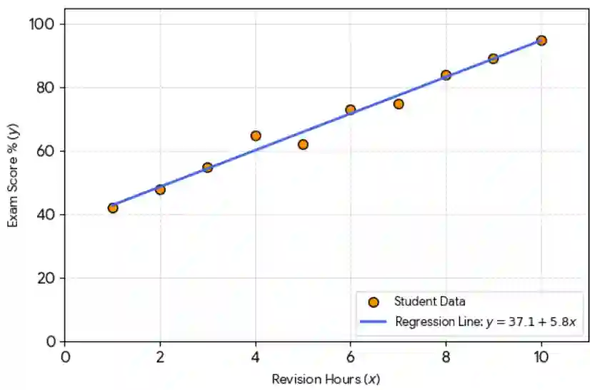

## Linear Regression Model

* In this example, we will modeling the relationship between the hours spent revising ($x)$ and the exam score achieved $(y)$
  * $x $ is the independent variable

  * $y$ is the dependent variable

  * $b$ is the gradient (How much y changes for every increase in 1 unit of x)

    * How much score will increase for an increase in every hour studying

  * $a$ is the y-intercept

    * Your score if you don’t study at all
* **Key Assumptions:**
  * We assume the spread of the data points around the line is roughly equal across the entire range of x

  * We assume a straight-line relationship exists between the two variables
* **Why it might be inaccurate:**
  * Using the model to predict values outside the range of the original data is highly unreliable

  * If the true relationship curves, forcing a straight line onto the data will lead to terrible predictions

  * A single outlier can pull the regression line away from the trend of the rest of the data

  * 