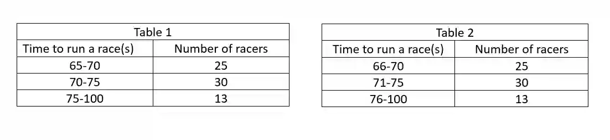

## **Ungrouped Data vs Grouped Data**

**Ungrouped Data**

* Raw, individual data points listed one by one. Each specific value is known exactly. The examiners can ask the mode, median and mean by asking you to calculate from the given ungrouped data

* *Example:* The test scores of 5 students are: (12, 15, 15, 18, 20)

**Grouped Frequency Data & Boundary**

* Data can be compressed into grouped frequency tables. When reading intervals, students must identify the class boundaries, midpoint, and class width.

  

#|
||

ㅤㅤㅤ

|

Table 1 (Overlapping boundaries)

|

Table 2 (Boundary with gaps)

||
||

**Class boundaries**

|

* 65$\le$ x $<$ 70

* 70$\le$ x $<$75

* 75$\le$ x $<$100

|

* 65.5$\le$ x $<$ 70.5

* 70.5$\le$ x $<$75.5

* 75.5$\le$ x $<$100.5

||
||

**Mid point**

|

* $\frac{1}{2}(65+70) = 67.5$

* $\frac{1}{2}(70+75) = 72.5$

* $\frac{1}{2}(75+100) = 87.5$

|

* $\frac{1}{2}(65.5+70.5) = 68$

* $\frac{1}{2}(70.5+75.5) = 73$

* $\frac{1}{2}(75.5+100.5) = 88$

||
||

**Class width**

|

* 70-65 = 5

* 75-70 = 5

* 100-75 = 25

|

* 70.5-65.5 = 5

* 75.5-70.5 = 5

* 100.5-75.5 = 25

||
|#

* **Boundary Rule:** There is a gap between 70 and 71. The true mathematical boundaries are found by taking the midpoint of the gap. It is not necessarily always 0.5

* **For data given in a frequency table, the mean can be calculated using the formula** $\overline{x} = \frac{\sum xf}{\sum f}$

**Mode vs modal class/ Median vs median class**

* For ungrouped data, we find exact values

* For grouped data, we find the interval containing those values (**the** **class**)

  * The questions might require you to find the mode/median using interpolation if the data is given in a grouped data