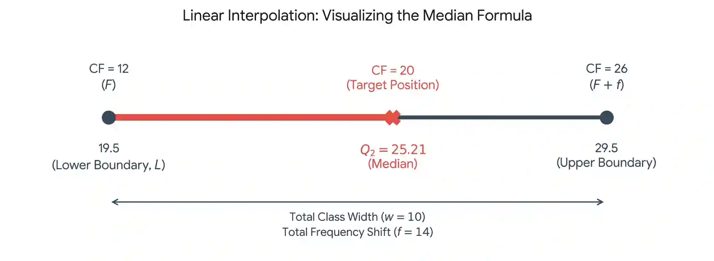

## **Grouped Continuous Data (Linear Interpolation)**

* For continuous data groups, we assume data points are evenly distributed across the class width. We  use cumulative frequencies and interpolation to estimate quartiles

  * (e.g median position $\frac{n}{2}, Q_1 position =\frac{n}{4}$ , 90th percentile =$\frac{90n}{100}$.)

* The Interpolation Formula

  $\boxed{V=L+\frac{P-F}{f} \times w}$

  * **V**: estimated value

  * **L**: lower class boundary

  * **P**: the data position that you want

  * **F**: total frequency of all the classes up to (Previous cumulative frequency)

  * **f**: class frequency of the specific class interval containing your target value

  * **w**: class width

    * This formula uses similar triangles (proportionality). It adds a fraction of the total class width (***w***) to the lower class boundary (***L***), proportional to how far along the cumulative frequency scale the target item sits inside that specific group frequency (***f***).

**Example question**:

Find the median (\\(Q\_\{2\}\\)) for the following table where the total frequency= 40

#|
||

Class

|

Frequency

|

Cumulative frequency

||
||

10-19

|

12

|

12

||
||

20-29

|

14

|

26

||
|#

**Formula Substitution Answer:**

* The median position= $\frac{40}{2} = 20$ falls into the second group
* L = 19.5, F = 12, f = 14, w = 10
* $Q_2$= 19.5 \+ $\frac{20-12}{14} \times 10$

**Visualizing Answer:**

* $\frac{\text{Partial Frequency Distance}}{\text{total Frequency in Class}} = \frac{\text{Partial Value Distance}}{\text{total Class Width}}$
* $\frac{20-12}{26-12} = \frac{Q_2-19.5}{29.5-19.5} $
* $ Q_2= 19.5 + \frac{20-12}{14} \times 10 $
* $Q_2 = 25.21$