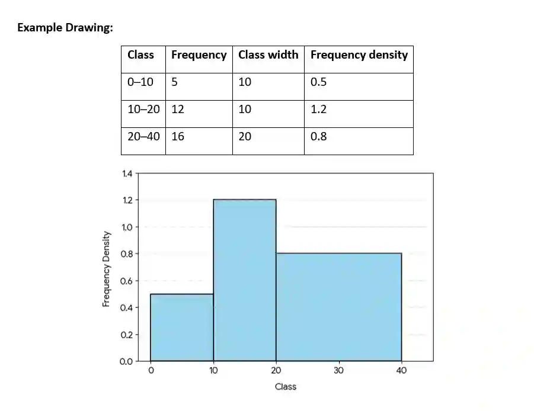
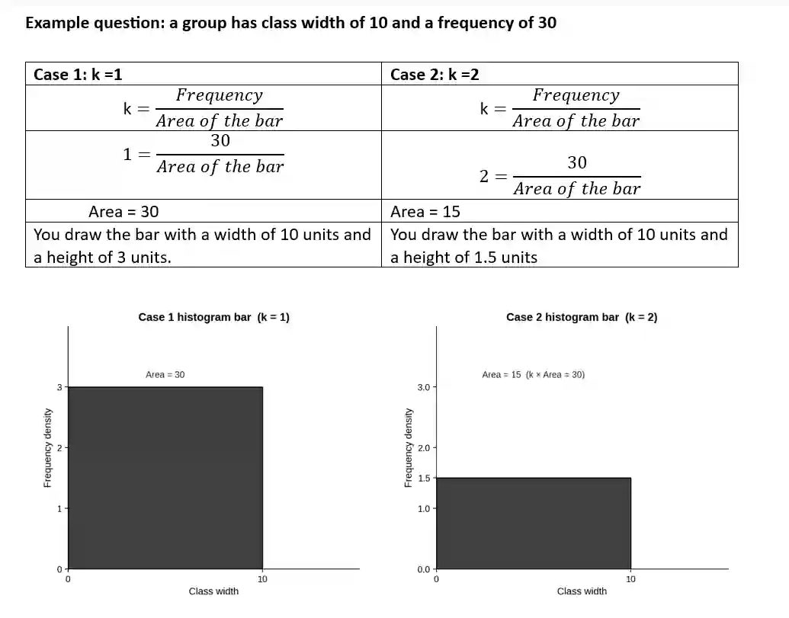

# Representation of Data

## Histogram

* Histograms are used to represent grouped continuous data

* The area of the bar is proportional to the frequency

* It is important when class widths are not equal, because the height must then be adjusted using frequency density

#|
||

Drawing a histogram

||
||

* 1. Find each class width

||
||

* 2. Calculate frequency density for each class

||
||

* 3. Draw bars with width equal to class width

||
||

* 4. Use frequency density for height

||
||

* 5. Make sure the area, represents frequency

||
|#

### The k ratio

* *k* is a scale factor that you multiply the area by, to get that frequency:

  $\text{frequency = Area of bar} \times k$

* It converts the physical drawing measurements into actual data frequencies.

* If a question tells you that a bar of a certain width and height represents a specific frequency, you calculate the area of that drawn bar (width x height) and use it to find k:

  * k=$\frac{\text{Frequency}}{\text{Area of the bar}}$

Note: The exam questions might ask you to find k or frequency by giving the graph and partial data

Frequency Polygons

* A frequency polygon is a line graph formed by joining the midpoints of the tops of each histogram bar with straight lines

  