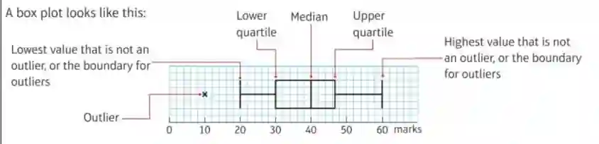

## Box Plots

### Drawing a box plot

1. Find the minimum, $Q_1$, median, $Q_3$, maximum

2. Draw number line

3. Draw a box from $Q_1$ to $Q_3$

4. Draw the median line inside the box

5. Extend whisker (boundaries) to the smallest and largest non-outlier values

6. Plot any outliers (if there is any) as crosses, and outside the box like in the image above

7. Add labels