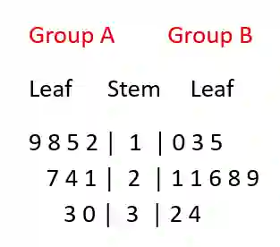

## Stem and leaf diagrams

* A stem and leaf diagram is a tool for displaying the shape of a distribution while preserving every individual raw data value

* Structure:

  * Stem= leading digits

  * Leaf= final digit

  * The leaves are written in ascending order

### **Drawing a standard stem and leaf**

**Example 1:**

Key: 4 \| 2 means 42 marks

2 │ 1 3 5

3 │ 0 2 2 7 9

4 │ 2 5 8

5 │ 0 1

Reading data points: The first row contains the values: 21, 23, 25

The second row contains: 30, 32, 32, 37, 39

To get the total sample size, count the leaves= 13

**Example 2:**

Key: 3 \| 1 \| 4 means 13 seconds for Group A and 14 seconds for Group B

Reading group A: Read from center to left--\> 12, 15, 18, 19, 21, 24, 27, 30, 33

Reading group B: Reading from center to right--\> 10, 13, 15, 21, 21, 26, 28, 29, 32, 34